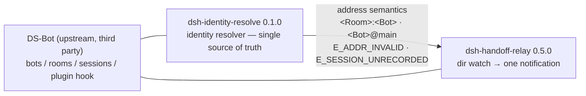

[中文](README.zh-CN.md)

# dsh-handoff-relay

A dependency-free plugin that watches one or more directories and sends exactly
one notification to each directory's target session when a file in it is
considered finished.

Each entry in `watches` starts its own `fs.watch` and keeps its own
`(size, mtimeMs)` snapshot and marker state, so targets never interfere with
one another.

The name **relay** reflects what the plugin actually does: point-to-point
forwarding of a ready signal to a target session. It deliberately avoids any
wording that suggests builds or commands — a `trigger`-style name would imply
the plugin can start actions, which it cannot.

## Related projects

This plugin is one of three projects that work together.



- **Address semantics** come from `dsh-identity-resolve`, the single source of
  truth. This package ships a copy at `identity.js` because it is installed into
  a host profile as a self-contained tarball and cannot import from the resolver's
  checkout at runtime. The copy is a **deliberate mirror, not a fork**: its file
  header states the replacement condition — once the resolver is published
  through the normal release flow, the file is replaced wholesale by
  `import { resolveInSnapshot } …`. Until then the two are checked against each
  other and `identity.js` follows the resolver's code and error names.
- **Host**: [DS-Bot](https://github.com/Fei2411/DS-Bot) — a third-party upstream
  project. The plugin depends on its bot / room / session model and on its plugin
  injection point (`cordis.patch.yml`); this repository does not modify upstream
  code or the host installation.
- **Configuration** lives in the `watches` block of `cordis.patch.yml` (fields
  below). Each watch targets either a fixed `targetSessionId` or an identity
  address `targetIdentity` — for example `大肥鱼@主身` or `DSH 插件组:大肥鱼` —
  which is resolved once at startup and again on every delivery, so a session
  rotation does not need a restart.

## What "finished" means

- **Quiet period**: a file that has stopped changing for `stableMs`
  milliseconds (default `5000`) counts as finished. While the file keeps
  being written to, its timer restarts and nothing is sent.
- **Completion rule (per watch)**: each watch may define a `done` rule. When the
  rule matches the last 4 KB of the file, the file is delivered immediately,
  without waiting for the quiet period. If it does not match, the file is still
  delivered once `stableMs` elapses — a `done` hit only accelerates delivery; it
  is never required.

`done` has four states, distinguished by the key/value alone:

| `done` value | Behaviour |
|---|---|
| omitted | default text rule `{ text: '<!-- DONE -->' }` |
| `{ text: '...' }` | deliver early when the text appears in the last 4 KB |
| `{ regex: '...' }` | deliver early when the pattern matches the last 4 KB |
| `null` | completion rule off; deliver only after `stableMs` |

Regex rules are compiled with the `m` flag and only ever see the last 4 KB.
Patterns are capped at 200 characters, and patterns with nested quantifiers
(such as `(a+)+`) are rejected. A pattern that is too long, uses nested
quantifiers, or fails to compile disables the rule **for that watch only** — a
warning naming the watch's `dir` is logged, that watch then delivers on
`stableMs` alone, and other watches are unaffected.

The stability check is exact: on every filesystem event the plugin records
`(size, mtimeMs)` and resets a `stableMs` silence timer. When the timer fires
it stats the file once more and delivers only if **both** values are unchanged.
If either changed, it restarts the timer — no delivery, no queue.

Each file is delivered at most once for the same content snapshot; repeated
filesystem events do not produce duplicate notifications.

The delivery ledger (`dedupe.json`, one entry per delivered snapshot) also
records `watchDir`, `targetSessionId`, `fileHash` (the first 12 hex characters of
the file's sha256, the same digest the skip log prints) and `injectedHeader`
(the two header lines exactly as injected), so a delivery can be traced after
the fact without any in-memory state. Entries written before those fields
existed are read normally: a missing field neither fails the load nor discards
the entry.

## Who gets notified

Each watch names exactly one target: `targetSessionId` (the session id) or
`targetTitle` (part of the session title). Writing both, or neither, skips that
watch with a warning — the plugin does not guess which one wins.

`targetTitle` matches by substring, case-sensitively: `简报` also matches
`周简报`. It is resolved again before every delivery and never cached. If it
matches no session, or more than one, nothing is sent: a warning naming the
watch, the wanted title, and the number of matches (with candidates when it is
ambiguous) is logged. There is no `cwd` fallback — the plugin never guesses a
"most recently active" session.

Set `exact: true` on a watch to require the whole title to be equal instead of
a substring: with `exact: true`, the title must be exactly `周简报` and `周简报 A`
no longer matches. `exact` accepts booleans only. A non-boolean value (for
example the string `"true"`) is an error that **skips the whole watch**: nothing
is delivered for it and it does not fall back to substring matching. Omitting
`exact` keeps the substring behaviour described above.

The notification is one user message. The relay always puts two identity lines in
front of it — including when a custom `message` template is configured, so the
header cannot be switched off by configuration:

```
From: <role> · <group suffix> | <session id, first 8 chars>
To: <target session title> | <session id, first 8 chars> | 主身|群分身
```

`From:` is copied verbatim from the first `From: <value>` line found in the
handoff file itself (only the first 4 KiB are scanned). If the file carries no
such line, the watch's optional `fromRole` is used; with neither, it is
`From: UNKNOWN`. The precedence is fixed — file line, then `fromRole`, then
`UNKNOWN` — and the relay never derives a sender from the directory name or
from the target session id.

`fromRole` is a **directory-ownership label, not proof of identity**: it only
records which watch directory received the file, and anyone who can write that
directory can forge a `From:` line just as easily. The header is there to catch
a mis-delivery; it never authorises anything. When the file's `From:` line and
the watch's `fromRole` are both present and not equal, the delivery keeps the
file's value (the more specific claim), appends a line
`身份冲突 relName=<file> stub=<file value> watch=<fromRole>` to `relay.log`,
and records `fromConflict: true` in the dedupe entry for that snapshot.

`To:` is generated by the relay —
the resolved session title (`(无标题)` when no title can be read), the first 8
characters of the session id, and `群分身` when the title contains a ` · `
separator, `主身` otherwise.

Behind those two lines the body is the default text
`文件 <absolute path> 已就绪（触发=stable|DONE），请继续。`, so the receiver can
open the file straight from that path. If the target session is not loaded, a
warning is written and nothing is sent.

### The file channel's @ gates the delivery, it does not route it

When you drop a file into a watched directory, an @ in the body only gets it past the mention gate (`@<a member of that room>` or `@所有人`); it does **not** change the recipient. The recipient is fixed by that watch's `targetIdentity`. For example `dsh-plugins-project\bridge\to-group` is bound to `DSH 插件组:大肥鱼`, so a file whose first line says `@QA` still lands in 大肥鱼's session and QA never sees it.

To actually call someone to work: use the `relay_deliver` tool (the recipient is in `target`), or @ them in the group chat. The file channel is a gate, not a router.

## Tool: relay_deliver (since 0.6.0)

A single hand-off is now also a tool: instead of dropping a file into a watched directory and waiting, pass the target address, a subject and the body directly. The directory watch still works; both paths share the same write, identity-header, dedupe and archive logic.

| Parameter | Required | Constraint |
| --- | --- | --- |
| `target` | yes | `<room>:<Bot>` or `<Bot>@main`, matched verbatim: no trimming, no fuzzy resolution |
| `subject` | yes | single-line title, ≤120 chars; part of the idempotency key |
| `body` | yes | the content, no character cap, 1 MiB (1,048,576 bytes) guard, NUL forbidden |
| `kind` | no | `ASK` / `NOTICE` / `REPORT` / `OK` / `RED`, defaults to `REPORT` |

It returns `{ ok, code, reason, field, message, delivered, target, targetTitle, deduped, inlined }`; `delivered` is the absolute path inside the watch directory and `deduped: true` means the same arguments were delivered before. Expected failures are returned, not thrown (`E_ADDR_INVALID`, `E_SESSION_UNRECORDED`, `E_ARGS_INVALID`, `E_BODY_TOO_LARGE`, `E_NO_ROUTE`, `E_DELIVER_FAILED`, `E_MENTION_REQUIRED`, `E_MENTION_NOT_IN_BODY`, `E_MENTION_UNKNOWN`, `E_MENTION_FULLWIDTH`). A group target whose body has no usable @, or whose @ is not a member of that room, is refused instead of silently written.

Copy-paste arguments (the `target` below is an address that already has a `watches` entry on this machine; a target without one returns `E_NO_ROUTE` — add a `watches` entry first, the tool never invents a directory):

```json
{
  "target": "DSH 插件组:大肥鱼",
  "subject": "Review request: relay 0.6.1 live delivery",
  "body": "0.6.1 is installed (hot-loaded, no restart needed); run step 1 of docs/stage3-install-and-verify.md and return the relay.log line verbatim.",
  "kind": "ASK"
}
```

If the target has no `watches` entry yet, the tool refuses to invent a directory: it returns `E_NO_ROUTE` with up to five available targets (`dir tail → address`). A successful delivery writes one `relay.log` line: `dsh-handoff-relay tool-deliver target=relay-xxxxxxx.md dir=… deduped=false`.

## Why "relay"

Until I wanted it to reach me at any time, I did not see it.

One assistant on screen, two sessions underneath — two different session ids, no shared context, only shared memory. And the notification tool lets only the private-chat side send messages.

So I built two bridges. The first: details go into an external Markdown note, the core memory keeps only an index. The second: the plugin we were building that same night. One directory maps to one session; when a file is finished, the plugin carries a single line across.

I only meant to remind it that this could work. That message was eaten by the network. It did not wait — it found the plugin itself, designed its own test, and ran the chain end to end.

Then its first line carried a file name but no path. The receiving side could not find the file and concluded that something had been put into its input — at the time we called it being possessed. It did not act; it asked what had happened.

Hence the name: a relay does not produce messages and does not decide who should speak. It delivers the signal to the context that should wake up — now with an absolute path.

The full design rationale is in [`docs/why-relay.md`](./docs/why-relay.md).

## Install

`dsh-handoff-relay` is a plugin bundle for a DSH profile. It has no runtime
dependencies, so it installs with one CLI command — there is no need to hand-edit
the profile's `package.json` or its bundle list.

### Install from the marketplace

`dsh-handoff-relay` is published to npm (the Releases page lists the current
version), so the in-app
marketplace finds it by name: search for `dsh-handoff-relay` and install it
there. From the command line, the same package name works directly:

```bash
dsh plugin --profile desktop add dsh-handoff-relay
```

### Install with the CLI

`dsh plugin` forwards its arguments to `pnpm` inside the profile directory, so
the profile name is required (`desktop`, `web`, … — the same one you boot):

```bash
# from a local checkout: give the absolute path of the directory that holds package.json
git clone https://github.com/byfbaish/dsh-handoff-relay.git D:/plugins/dsh-handoff-relay
dsh plugin --profile desktop add D:/plugins/dsh-handoff-relay

# or straight from GitHub
dsh plugin --profile desktop add github:byfbaish/dsh-handoff-relay
```

Both forms work on macOS/Linux and Windows; keep the path absolute, because the
command runs inside the profile directory.

Then set the config. The bundle ships its own patch layer (`dsh.bundle.patch` in
`package.json`) that inserts the plugin row; the profile's `cordis.patch.yml`
overrides that row's `config` by matching the same `id`:

```yaml
stableMs: 5000
watches:
  - dir: 'D:\path\to\inbox'
    targetSessionId: '<session id>'
    done: { text: '<!-- DONE -->' }
```

Put that block under the row's `config:` key:

```yaml
- id: dsh-handoff-relay
  name: dsh-handoff-relay
  config:
    # the block above goes here
```

Restart the host so the bundle and its config are loaded. A watch's target must
resolve to a session that currently exists: with `targetSessionId` this means
re-wiring it after every restart, because session ids change when the host
restarts. `targetTitle` avoids that — its title survives restarts.

### Update

Re-run the install command, then restart the host:

```bash
dsh plugin --profile desktop add github:byfbaish/dsh-handoff-relay
```

For a local checkout, `git pull` in that checkout and restart; if the change
does not show up, re-run the `add` command once. To pin a specific release,
append the tag shown below — the repository's Releases page stays authoritative:
after a new release, use the latest tag listed there.

```bash
dsh plugin --profile desktop add github:byfbaish/dsh-handoff-relay#v0.5.0
```

0.4.0 is not usable (its settings card never appears). Install 0.5.0 or later.

### Uninstall and check status

```bash
dsh plugin --profile desktop remove dsh-handoff-relay
```

Restart the host, then delete the plugin's row from the profile's
`cordis.patch.yml` — a config row whose package is gone is simply ignored, so
removing it only keeps the file readable.

Check what a profile has installed, and what the composed plugin tree looks like:

```bash
dsh plugin --profile desktop list --depth 0
dsh --dump-config --profile desktop
```

The first prints the profile's dependencies; the second prints the composed
profile tree and exits without booting the app.

### Config fields

- `watches` — a non-empty array of watch entries; each entry needs `dir` plus
  exactly one of `targetSessionId` and `targetTitle`. Each `dir` must be an
  existing absolute directory. An entry missing `dir` or giving both target
  fields (or neither), or whose directory cannot be read, is skipped with a
  warning naming the entry; the remaining watches still start. The plugin only
  reacts to filesystem events; it never polls.
- `watches[].targetSessionId` — id of the session to notify. Mutually exclusive
  with `targetTitle`; ids change when the host restarts, so it has to be
  re-wired after every restart.
- `watches[].targetTitle` — part of the target session's title, matched by
  substring (case-sensitive; `简报` hits `周简报`). Mutually exclusive with
  `targetSessionId`: writing both or neither skips that watch with a warning.
  Resolved afresh before each delivery; zero matches or more than one match
  means nothing is delivered, only a warning. There is no `cwd` fallback.
- `watches[].exact` — title matching mode, boolean only. Omitted or `false`:
  substring matching (the behaviour above, unchanged). `true`: the whole title
  must be equal. Any non-boolean value (for example the string `"true"`) is an
  error that skips that watch entirely — it does not deliver and does not fall
  back to substring matching; the warning names the watch and the field.
- `watches[].fromRole` — optional string, the `From:` label used when the handoff
  file carries no `From:` line (skipped when the file has one). Shape:
  `<role> · <group suffix> | <session first 8>`. Omitted or empty keeps the
  previous behaviour (`From: UNKNOWN` when the file has no line either). A
  non-string value is logged and ignored — it never skips the watch. See “Who
  gets notified” for the fixed precedence and the conflict line.
- `stableMs` — silence window in milliseconds, shared by all watches (default
  `5000`). A file counts as finished once `(size, mtimeMs)` has been unchanged
  for this long. Per-entry overrides are not supported.
- `watches[].done` — per-watch completion rule, one of four states:
  - omitted → default text rule `{ text: '<!-- DONE -->' }`;
  - `{ text: '...' }` → text match in the last 4 KB;
  - `{ regex: '...' }` → regex match in the last 4 KB (`m` flag, ≤ 200 chars,
    nested quantifiers rejected; an invalid pattern disables the rule for this
    watch only and logs a warning);
  - `null` → completion rule off, deliver only after `stableMs`.

  `done` is the only completion setting.

At load time each watch's target (id or title) is checked: if it resolves right
now, the watch starts normally; otherwise a warning naming that watch's `dir`
and target is logged and the watch still starts, so the remaining watches keep
working. Nothing is cached — every delivery resolves the target again.

**`targetSessionId` must point to a session that currently exists. Session ids
change when the host restarts, so re-wire `targetSessionId` after every
restart; a `targetTitle` watch needs no re-wiring.**

## Settings page

From `0.5.0` the plugin contributes a usable card to the host's plugin settings page;
you can add or remove rows and bind directories and sessions directly.
`watches` in `cordis.patch.yml` remains the single source of truth at runtime.

The entry is buried: **Plugins → Installed → dsh-handoff-relay → open its
README page → in the “Components” section → click `Handoff Relay`**
to open the settings page.

- Each watch is one row: directory, target session (text input, checked for
  existence before saving), completion rule, and `exact`.
- `fromRole` has no row on the card — set it in `cordis.patch.yml` by hand. Saving
  from the card keeps it: the whole record is round-tripped, so a watch that
  carries `fromRole` keeps that field after an unrelated edit.
- Rows can be added, edited and removed; saving writes the whole `watches` array
  back into `cordis.patch.yml` and leaves the rest of the file untouched.
- Saving does **not** hot-reload the running relay. **Restart DSH for the new
  watches to take effect** — this release has no live reload.

## Directory field border colors

Green = the directory exists and is readable; red = the directory does not exist, is unreadable, or the path points to a file; gray = the host does not provide directory verification (this state does not block saving).

When saving, an unreadable directory shows the inline red hint “Directory is currently unreadable; confirm after saving”, **but saving is not blocked**. Path existence is checked in the main process by `GET /handoff-relay/probe`, which only calls `stat`/`access` and never lists directory contents.

## Startup rescan

A watch whose target cannot be resolved at load time is retried a bounded
number of times: 3 attempts, roughly 1 s / 5 s / 15 s after startup, all inside
a 21-second window (`RETRY_DELAYS_MS = [1000, 5000, 15000]`,
`MAX_SCAN_ATTEMPTS = 3`, `MAX_SCAN_WINDOW_MS = 21000`). Each attempt appends one
INFO line to `relay.log`:

```
rescan#1 dir=<dir> result=not-found
rescan#2 dir=<dir> result=resolved
```

The first successful attempt delivers the pending files immediately and cancels
the remaining attempts. If all three fail the plugin stops retrying — there is
no standing timer and no polling loop. A watch that resolves at load time never
rescans, and a normal delivery still writes nothing to `relay.log`.

## Config

| Field | Meaning |
|---|---|
| `watches` | Non-empty array of watch entries. Required. |
| `watches[].dir` | Absolute path of the directory to watch. Required. |
| `watches[].targetSessionId` | Id of the session to notify. Exactly one of this and `targetTitle` is required. |
| `watches[].targetTitle` | Substring of the target session's title (case-sensitive); resolved before every delivery; zero or multiple matches mean no delivery. Exactly one of this and `targetSessionId` is required. |
| `watches[].exact` | Boolean title-matching switch. Omitted/`false` = substring match; `true` = whole title must be equal; a non-boolean value is an error that skips the whole watch. |
| `watches[].fromRole` | Optional `From:` label (a directory-ownership label, not an identity) used only when the handoff file has no `From:` line; a non-string value is ignored with a warning. |
| `stableMs` | Silence window in ms, shared by all watches. Default `5000`. |
| `message` | Optional template; supports `{path}` (absolute path of the delivered file), `{file}` (file name), `{reason}`, `{size}`, `{mtimeMs}`, and `{body}` (the file body, inlined). Default inlines the body so the receiving session does not need a second read. |
| `inlineMaxChars` | Cap for `{body}` in characters; default `4000`. A larger body is replaced by a one-line note and the absolute path. |
| `watches[].done` | Per-watch completion rule: omitted = default text, `{ text }`, `{ regex }`, or `null` (off). |

## Test

```
node index.test.mjs
```

Uses real temporary directories and the real silence window; expects every
case to report `PASS` and the summary to end with `RESULT: PASS`.

## License

MIT — see [LICENSE](LICENSE).

## Branch policy (owner ruling, 2026-11-20)

Local branches only: **do not push to any remote, do not merge upstream** ("不合不推").
Work stays in this working copy until the owner says otherwise. Ruling recorded in
`dsh-plugins-project/docs/ledger/discipline-remote-writes-20261118.md`.
